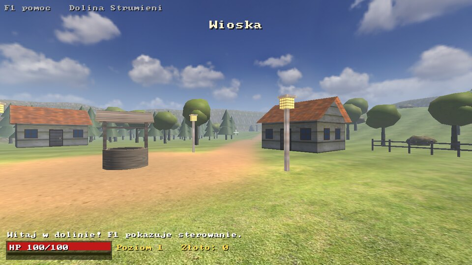
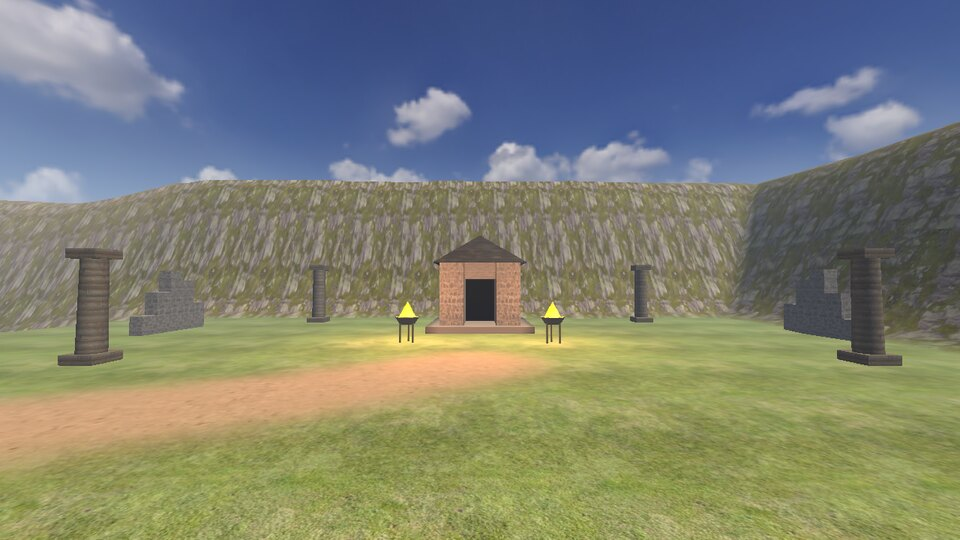
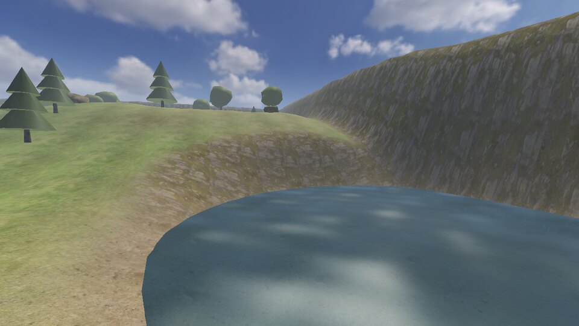
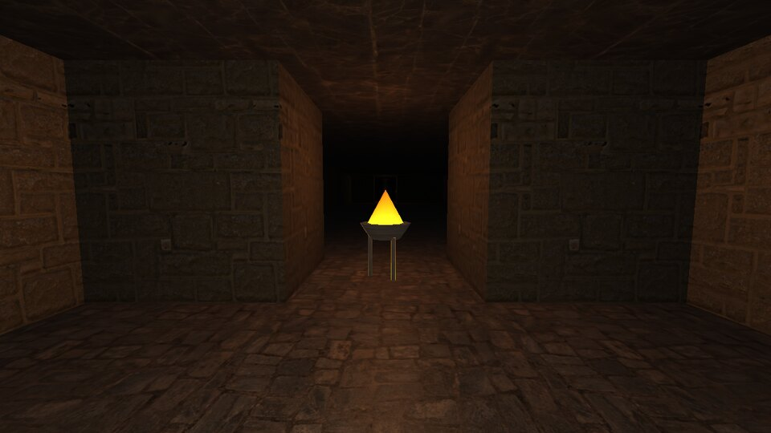
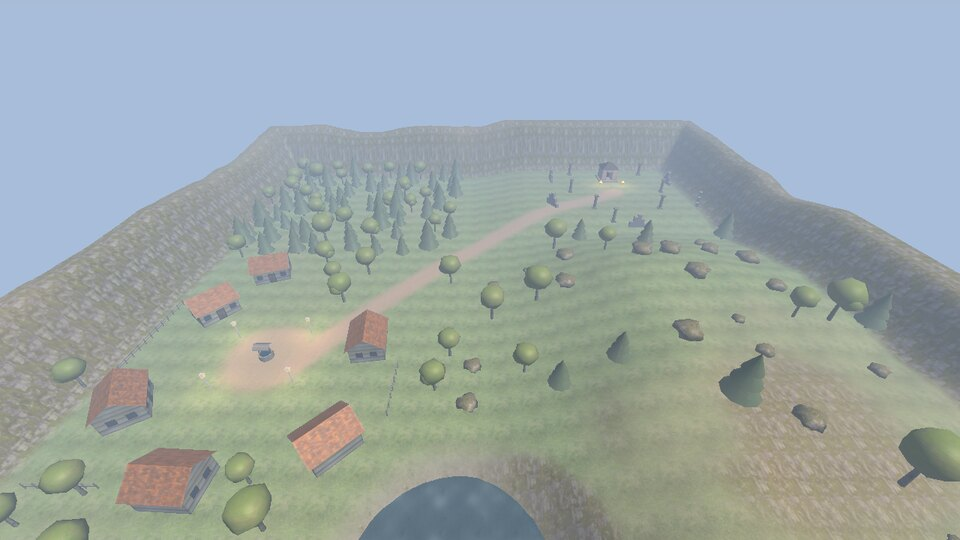
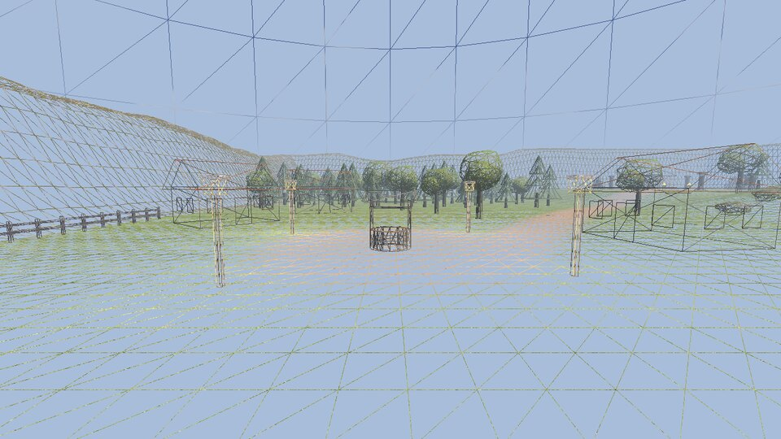

# PwAG_projekt

Gra RPG z widokiem z pierwszej osoby, inspirowana serią Might and Magic (głównie częścią VII).
Projekt na zajęcia z **Programowania w API Graficznych**. Silnik jest napisany od podstaw w C++17
i OpenGL 3.3, bez gotowych silników i middleware. Gra działa na Windowsie i na Linuxie.



**Autorzy:** Michael Musiol, Michał Kaleta, Aleksander Król, Konrad Patoń (grupa 1)

**Prowadzący:** dr inż. Damian Pęszor

---

## O grze

Gracz zwiedza przygotowany świat, zbiera przedmioty, rozmawia z mieszkańcami i walczy z potworami.
Postać ma podstawowe statystyki i ekwipunek. Przeciwnicy i NPC to sprite'y w stylu MM7 - zależnie od
tego, jak stoją względem gracza, widać ich przód albo tył.

Lokacje:
- **Dolina Strumieni** - mapa 128 x 128 m podzielona na strefy: Wioska, Las, Wzgórza, Ruiny i Jezioro.
  Nazwa strefy wyświetla się po wejściu do niej.
- **Krypta Zapomnianych** - podziemia pod ruinami, z korytarzami, salami kolumnowymi i dużą liczbą
  przeciwników. Oświetlają ją pochodnie na ścianach, koksowniki i latarnia, którą niesie gracz.

## Zrzuty ekranu

| | | |
|---|---|---|
|  |  |  |
| Ruiny i wejście do krypty | Jezioro (falująca woda) | Krypta |
|  |  |  |
| Dolina z lotu ptaka (F3) | Siatka trójkątów (F2) | Interfejs |

## Stan prac

| Etap | Zakres | Termin | Stan |
|---|---|---|---|
| 1 | Budowanie, silnik graficzny, obie lokacje, ruch, kamera, kolizje, przejścia | 26.11.2026 | gotowe |
| 2 | Przedmioty, podnoszenie, ekwipunek i jego ekran | 05.12.2026 | w planach |
| 3 | Potwory, walka w czasie rzeczywistym, łup, poziomy postaci | 14.12.2026 | w planach |
| 4 | NPC, dialogi, zadanie, docelowe modele i grafiki (wersja beta) | 15.01.2027 | w planach |
| 5 | Poprawki, testy, raport końcowy (wersja finalna) | 29.01.2027 | w planach |

Szczegółowy plan, decyzje i formaty danych są w [PLAN.md](PLAN.md).

## Wymagania z regulaminu

| Wymaganie | Realizacja |
|---|---|
| Nawigacja myszą i klawiaturą | WASD + mysz, strzałki (jak w MM7), wolna kamera pod F3 |
| Podgląd siatki (wireframe) | F2 |
| Zewnętrzne, teksturowane obiekty | modele OBJ z teksturami BMP (domy, drzewa, studnia, ruiny, koksowniki...) |
| Sprzętowe bufory wierzchołków i indeksów | każda siatka w VAO + VBO + IBO, rysowanie przez `glDrawElements` |
| Programy wierzchołków i fragmentów | kontekst OpenGL 3.3 core - stały potok jest niedostępny |
| Obiekty z więcej niż jedną teksturą | teren: cztery tekstury mieszane splatmapą w shaderze |
| Dynamiczne oświetlenie | Phong liczony na piksel: słońce + do 16 świateł punktowych; migoczący ogień, latarnia poruszająca się z graczem |
| Brak middleware | tylko OpenGL; freeglut (okno i wejście, następca GLUT z laboratoriów) i GLM (matematyka) |

## Budowanie i uruchamianie

### Co trzeba mieć

**Windows** - jedno z dwóch:
- **Visual Studio Community** z pakietem "Programowanie aplikacji klasycznych w języku C++" oraz
  [CMake](https://cmake.org/download/) (przy instalacji zaznaczyć *Add CMake to the system PATH*),
- **MSYS2** ([msys2.org](https://www.msys2.org/)) z MinGW:
  ```
  pacman -S mingw-w64-ucrt-x86_64-gcc mingw-w64-ucrt-x86_64-make mingw-w64-ucrt-x86_64-cmake
  ```
  i katalog `C:\msys64\ucrt64\bin` dodany do zmiennej PATH.

**Linux:**
```
# Fedora
sudo dnf install gcc-c++ cmake mesa-libGL-devel mesa-libGLU-devel libX11-devel libXi-devel libXrandr-devel
# Arch Linux
sudo pacman -S --needed base-devel cmake mesa glu libx11 libxi libxrandr
```

Do tego karta graficzna z obsługą OpenGL 3.3. Biblioteki freeglut i GLM są w repozytorium (`external/`),
więc niczego więcej nie trzeba pobierać.

### Uruchomienie

| | Windows | Linux |
|---|---|---|
| Zbudowanie | dwuklik na `build.cmd` | `sh build.cmd` |
| Uruchomienie | dwuklik na `run.cmd` | `sh run.cmd` |

`build.cmd` sam wybiera kompilator (Visual Studio, a jeśli go nie ma - MinGW). `run.cmd` przed startem
dobudowuje zmienione pliki. Plik wykonywalny trafia do `bin/`. Grę trzeba uruchamiać z głównego katalogu
projektu, bo wczytuje pliki z `data/` i `shaders/` - `run.cmd` robi to automatycznie.

Ręcznie, bez skryptów:
```
cmake -S . -B build -DCMAKE_BUILD_TYPE=Release
cmake --build build --config Release
./bin/gra            # Windows: bin\gra.exe
```

## Sterowanie

| Klawisz | Akcja |
|---|---|
| W A S D, strzałki góra/dół | ruch |
| mysz, strzałki lewo/prawo | rozglądanie się, obrót |
| PgUp / PgDn | patrzenie w górę / w dół |
| Shift | bieg |
| E | interakcja: przejście do innej lokacji (później także podnoszenie i rozmowa) |
| LPM / Spacja | atak (etap 3) |
| I | ekwipunek (etap 2) |
| F1 / Esc | pomoc i pauza |
| Q | wyjście z gry (na ekranie pomocy) |
| F2 | siatka trójkątów |
| F3 | wolna kamera (Spacja / C - w górę / w dół) |
| F4 | znaczniki źródeł światła i pozycja gracza (x, z) na górnym pasku |
| F12 | zrzut ekranu do katalogu `screenshots/` |

## Struktura projektu

```
CMakeLists.txt         konfiguracja budowania
build.cmd, run.cmd     skrypty (działają w cmd.exe i w sh)
src/
  main.cpp             okno freeglut, kontekst OpenGL 3.3 core, obsługa klawiatury i myszy, pętla gry
  render.h/.cpp        grafika: shadery, tekstury BMP, modele OBJ, kamera, światła, teren, sprite'y,
                       niebo, woda, efekt rozpadu, interfejs 2D i tekst, zrzuty ekranu
  world.h/.cpp         lokacje: wczytywanie map, teren z heightmapy, krypta z siatki znaków,
                       obiekty, światła, strefy, przejścia, kolizje
  game.h/.cpp          rozgrywka: gracz, ruch, interakcja, HUD, ekrany pomocy i śmierci
  font8x8.h            czcionka bitmapowa z polskimi literami
shaders/
  world.vert/.frag     scena 3D: oświetlenie Phonga, mgła, teren, sprite'y, niebo, woda
  explode.geom         shader geometrii - rozpad sprite'a na cząsteczki
  ui.vert/.frag        interfejs 2D
data/
  maps/                dolina.txt, krypta.txt
  models/              modele OBJ
  textures/            tekstury BMP
external/              freeglut 3.8.0, GLM 0.9.9.3, glext.h (Windows)
docs/                  zrzuty ekranu do README
```

Kolejne etapy dochodzą jako osobne pliki: `inventory.cpp` (przedmioty), `combat.cpp` (walka)
i `dialog.cpp` (NPC i dialogi). Wszystkie struktury danych są już opisane w `src/game.h`.

## Jak działa silnik - w skrócie

- **Rysowanie** odbywa się wyłącznie przez shadery. Jeden program (`world.vert` + `world.frag`) rysuje
  wszystkie obiekty 3D w kilku trybach: model, teren, sprite, niebo, woda.
- **Teren** powstaje z heightmapy (obraz w odcieniach szarości -> siatka wierzchołków z normalnymi).
  Splatmapa (kanały R, G, B) mówi shaderowi, ile w danym miejscu ma być ziemi, skały i piasku na tle trawy.
- **Krypta** jest opisana siatką znaków w pliku tekstowym. Z niej budowane są ściany (tylko te widoczne),
  podłoga i sufit, a znaki specjalne stawiają pochodnie, koksowniki, kolumny, potwory i przedmioty.
- **Oświetlenie**: słońce (światło kierunkowe) i do 16 najbliższych świateł punktowych liczone na piksel
  modelem Blinna-Phonga, z mgłą zależną od odległości.
- **Kolizje**: ruch osobno w osi X i Z (ślizganie się wzdłuż ścian), okręgi i obrócone prostokąty
  wokół obiektów, granice obszaru mapy, blokada zbyt stromych zboczy, siatka ścian w krypcie.
- **Interfejs** rysowany jest prostokątami i własną czcionką bitmapową (z polskimi znakami).

## Edycja świata

Mapy to zwykłe pliki tekstowe w `data/maps/`. Na początku każdego pliku jest opis wszystkich komend.
Przykłady:

```
prop  dom.obj dom.bmp  47 80  135  1.0  6x5     # model tekstura x z kąt skala kolizja
prop  skala.obj skala.bmp 90 70  20  1.5  1.5    # kolizja okrągła o promieniu 1.5 m
bounds 10 10 118 118                            # obszar, po którym można chodzić
light 26 78 3.0   1.0 0.78 0.45  11 flicker     # x z wysokość  kolor  zasięg  [migotanie]
zone  10 62 55 104 Wioska                       # prostokąt strefy i jej nazwa
portal 100 21.2 1.4 krypta.txt                  # przejście do innej mapy (klawisz E)
```

Kolizja obiektu to promień okręgu (np. `0.6`), prostokąt o wymiarach modelu `szerokość x głębokość`
(np. `6x5`, obraca się razem z modelem) albo `0`, gdy przez obiekt można przejść.

Krypta to siatka znaków: `#` ściana, `.` podłoga, `S` start, `E` wyjście, `T` pochodnia (wisi na
sąsiedniej ścianie), `K` koksownik (stoi na środku pola), `P` kolumna, `r g s B` potwory, `m M $ t k` przedmioty.

**Własne modele i tekstury** wystarczy podmienić w `data/models/` i `data/textures/` (ta sama nazwa pliku),
bez zmian w kodzie:
- OBJ z Blendera: *File > Export > Wavefront OBJ*, zaznaczone *Triangulate Faces*, *UV* i *Normals*,
  Forward -Z, Up Y; 1 jednostka = 1 m, punkt (0,0,0) u podstawy obiektu, jedna tekstura na model.
- BMP 24-bit (albo 32-bit z kanałem alfa), najlepiej o wymiarach będących potęgą dwójki.
  Kolor magenta (255, 0, 255) jest traktowany jako przezroczysty.

## Technologie i narzędzia

C++17, OpenGL 3.3 core, GLSL 330, CMake, GCC / MSVC, freeglut, GLM.
Grafika i modele: Blender, Krita, GIMP, Pixel Studio. Kod: Visual Studio Code, NeoVim.

## Źródła i licencje

- Kod projektu: licencja GPL-3.0 (plik [LICENSE](LICENSE)).
- [freeglut](https://github.com/freeglut/freeglut) - licencja MIT X11 (`external/freeglut/COPYING`).
- [GLM](https://github.com/g-truc/glm) - licencja MIT / Happy Bunny (`external/glm/copying.txt`).
- Czcionka na bazie [font8x8](https://github.com/dhepper/font8x8) (domena publiczna), polskie litery dorysowane.
- Tekstury z [Poly Haven](https://polyhaven.com) (CC0): dirt_floor, aerial_rocks_02, coast_sand_01,
  stone_brick_wall_001, cobblestone_floor_06, dark_rock, bark_brown_02, leafy_grass, clay_roof_tiles_02,
  beam_wall_01, brown_planks_04, old_stone_wall, granite_wall; niebo: kloofendal_48d_partly_cloudy_puresky.
- Tekstura trawy (`trawa.bmp`) pochodzi z materiałów do laboratorium nr 2 (źródło: amazingtextures.com).
- Obecne modele w `data/models/` są tymczasowe i zostaną zastąpione modelami wykonanymi w Blenderze.
